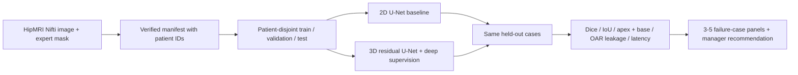

# HipMRI prostate segmentation: does 3D context help at the apex and base?

**COMP3710 tutor exemplar · Hard difficulty · 3D Improved U-Net**

This project studies whether a residual 3D U-Net with deep supervision gives more useful prostate contours than a standard slice-wise 2D U-Net. The intended user is a radiotherapy contouring specialist who would inspect and edit a draft contour. Global Dice alone can hide dangerous errors at the prostate apex and base, or false-positive contour inside the bladder and rectum. Both models are trained on the same patient-disjoint HipMRI split, then compared on whole-volume overlap, edge-slice overlap, anatomical leakage, inference time, and memory use. This is research software, not a clinical device.

> **Evidence status:** Code and a synthetic end-to-end smoke test are complete. HipMRI images and labels have not been supplied to this computer. The synthetic test verifies that the pipeline runs; it is not a clinical result. No HipMRI accuracy, anatomical error analysis, or deployment claim is made until the course data are run.

## Working principles

The baseline is a 2D U-Net that processes each axial MRI slice independently. The proposed model uses 3D convolution, skip connections, residual blocks, and two auxiliary segmentation heads during training. Both predict background or prostate from a normalized Nifti volume. Image volumes are reoriented to canonical axes, clipped at the 0.5th and 99.5th nonzero-intensity percentiles, standardized per case, and resampled to a fixed `[D,H,W]` grid with trilinear interpolation. Anatomical label maps use nearest-neighbor interpolation. Cross-entropy and a prostate Dice loss train the main head; auxiliary 3D heads add lower-resolution losses. The evaluation uses the same resampled cases and masks for both models.



The design follows [U-Net](https://arxiv.org/abs/1505.04597), [3D U-Net](https://arxiv.org/abs/1606.06650), and the residual/deep-supervision direction of [Isensee et al.](https://arxiv.org/abs/1802.10508). It is an independent implementation, not a reproduction of their exact networks.

## One-page feasibility review

**User need and scope.** A contouring specialist needs a draft prostate mask that saves editing time without hiding edge-slice under-contours or leakage into organs at risk. This prototype compares a 2D baseline with a 3D candidate on the 3D HipMRI T2-weighted volumes and semantic masks described in the course brief. The intended output is an editable research contour and a case-level uncertainty/failure review, not autonomous treatment planning.

**Pre-registered acceptance criteria.** (1) No patient appears in more than one split, including repeated scan volumes. (2) The 3D model reaches the brief's mean held-out prostate Dice target of at least 0.70. (3) The 3D model improves mean apex or base Dice by at least 0.05 over the 2D baseline without a material increase in false-positive bladder/rectum voxels. (4) The proposed contour is generated within 5 seconds per volume on the target GPU and uses at most 16 GiB peak GPU memory. (5) Five low-performing cases have inspectable input/ground-truth/prediction/error panels and a written failure explanation. These are goals to test, not achieved results.

**Model and course concepts.** A slice-wise U-Net is a clean baseline because it has no through-plane context. The 3D residual model tests whether volumetric receptive fields reduce jagged slice transitions. Deep supervision provides training signals at two decoder scales. Patient-level grouping prevents scan-level leakage. A binary prostate target keeps the principal clinical question focused; the original semantic mask remains available to count overlap with bladder and rectum.

**Preliminary feasibility evidence.** A three-patient synthetic Nifti smoke test exercised split creation, label loading, a forward/backward pass for both networks, checkpoint saving, test inference, metrics, and error-panel generation. It cannot estimate clinical performance. The default grid is `64×128×128`; a one-case GPU resource pilot on Rangpur must be run before the full training job. The initial data audit must verify patient IDs, label IDs, affine alignment, volume dimensions, and available GPU memory.

**Risks, budget, and fallback.** The principal risks are misidentified patient IDs, wrong semantic label IDs, lost small structures during resampling, class imbalance, and 3D GPU exhaustion. The first experiment is a short baseline and 3D pilot on the same small training subset, with validation only. If memory exceeds budget, reduce the 3D grid or network width and document the resulting resolution loss; retain the working 2D baseline. Reserve the held-out test set until architecture and checkpoint selection are fixed.

## Data, preprocessing, and leakage prevention

The course brief locates 3D HipMRI images in `/home/groups/comp3710/HipMRI_Study_open/semantic_MRs` and semantic masks in `/home/groups/comp3710/HipMRI_Study_open/semantic_labels_only` on Rangpur. The data are **not included** in this repository. Never commit images, masks, or model weights.

Create a CSV with four columns: `case_id,patient_id,image,mask`. Each row represents a volume; multiple volumes from one patient must share the same verified patient ID. Absolute or manifest-relative paths work. If image and mask files share the same Nifti stem and a checked regular expression extracts the patient ID, `prepare_manifest.py` can create the CSV. If filenames differ, construct the CSV manually and inspect every pairing. Do not infer the patient ID from an unverified filename convention.

Run the audit before selecting mask IDs:

```bash
python audit_data.py --manifest /path/to/hipmri_manifest.csv --out runs/data_audit.json
```

The audit reports the original semantic label IDs, case dimensions, voxel spacing, and image/mask alignment. Identify the prostate, bladder, and rectum IDs from dataset documentation and representative masks. The training script requires the prostate ID and accepts the other two IDs for organ-at-risk leakage counts. It splits **patients**, not slices or volumes, with a fixed seed (3710) and target proportions 70%/15%/15%. The exact case assignment is saved in `runs/hipmri/split.json` and reused on reruns. The test set is read only after both best-validation models are selected. The same split and resized grid are used for both.

The binary target is encoded as two channels inside the Dice loss via PyTorch one-hot encoding. Cross-entropy receives integer class indices. Native mask labels are retained separately for bladder/rectum error counts. The present spatial metrics are in the **resampled grid**; physical-distance claims in millimeters require mapping predictions back to the original affine and evaluating in native space.

## Reproduce the experiment

Use Python 3.12 and install the exact versions in `requirements.txt`. On Rangpur, install a PyTorch build appropriate for its CUDA driver using the [official PyTorch instructions](https://pytorch.org/get-started/locally/); then install the remaining pinned packages. The local smoke test used CPU PyTorch 2.11.0. From this directory:

```bash
python -m pip install -r requirements.txt
python -m pytest -q tests
python audit_data.py --manifest /path/to/hipmri_manifest.csv
python train.py --manifest /path/to/hipmri_manifest.csv \
  --prostate-label PROSTATE_ID --bladder-label BLADDER_ID --rectum-label RECTUM_ID \
  --out runs/hipmri --device cuda --epochs 60 --size 64 128 128
python predict.py --manifest /path/to/hipmri_manifest.csv \
  --run-dir runs/hipmri --count 5 --device cuda
```

Replace the three uppercase IDs with integers verified by the audit. `train.py` trains the 2D U-Net and 3D Improved U-Net sequentially, chooses each checkpoint by validation prostate Dice, plots loss and validation Dice, and evaluates the locked test split once both models are selected. It produces `results.json`, `per_case.csv`, `2d_best.pt`, `3d_best.pt`, and training curves under `runs/hipmri`. `predict.py` loads saved weights, prints case Dice values, and writes five worst-case multi-panel figures plus `autopsy_index.csv` to `runs/hipmri/failure_cases`. The run directory is ignored by Git.

For a first GPU pilot, set `--epochs 1 --size 32 64 64 --width-3d 4 --width-2d 4`; this pilot cannot be used for final performance claims. Run long jobs as Slurm batch jobs on Rangpur according to the course cluster instructions.

## Quantitative results and failure analysis

The table below must be filled **only from the HipMRI `results.json` generated by the real-data run**. Empty cells are intentional at this stage.

| Held-out metric | 2D U-Net baseline | 3D Improved U-Net |
| --- | ---: | ---: |
| Patients / volumes | Awaiting HipMRI | Awaiting HipMRI |
| Prostate Dice / IoU | Awaiting HipMRI | Awaiting HipMRI |
| Background Dice / IoU | Awaiting HipMRI | Awaiting HipMRI |
| Apex Dice / base Dice | Awaiting HipMRI | Awaiting HipMRI |
| 95th-percentile surface distance (resampled voxels) | Awaiting HipMRI | Awaiting HipMRI |
| False-positive voxels inside bladder / rectum | Awaiting HipMRI | Awaiting HipMRI |
| Parameters / peak GPU VRAM / case latency | Awaiting HipMRI | Awaiting HipMRI |

For the 3-5 case autopsies, inspect the `failure_cases/*.png` panels and report each case ID, patient ID, observed false-positive/false-negative boundary, whether the failure occurs at the apex/base or near an organ at risk, a plausible image-level trigger, and whether 3D helped relative to 2D. Include both false positives and false negatives. A low Dice score identifies cases to inspect; it does **not** by itself establish the cause. Add additional examples if the worst five fail to cover both error types.

**Manager recommendation (pending real-data evidence):** Retain mandatory specialist review of every contour, especially apex/base slices and any predicted voxels inside bladder or rectum. Advance the 3D model only if its held-out boundary gain survives the case-level failure review and justifies its extra memory and latency. The generated masks are not suitable for clinical use without a larger external validation and a native-space dosimetric assessment.

## Code map

| File | Responsibility |
| --- | --- |
| `modules.py` | PyTorch-only 2D baseline and residual 3D model components |
| `dataset.py` | Nifti loading, normalization, verified patient splitting, 2D/3D datasets |
| `train.py` | Training, validation, locked test evaluation, checkpoints, curves, profiling |
| `predict.py` | Saved-weight inference and visual error panels |
| `metrics.py` | Case-level Dice, IoU, surface, apex/base, and OAR leakage metrics |
| `audit_data.py`, `prepare_manifest.py` | Data inspection and optional manifest construction |
| `tests/test_pipeline.py` | Synthetic alignment, leakage, shape, gradient, and metric checks |

## Artificial Intelligence Usage Disclosure

OpenAI Codex assisted the tutor in drafting the project structure, PyTorch implementation, documentation, and debugging. The tutor exemplar's code was reviewed by running syntax checks, two automated synthetic tests, a complete one-epoch synthetic training and prediction smoke test, and visual inspection of its output panel. The synthetic experiment checks software operation only. It does not verify HipMRI performance, clinical boundary quality, or the suitability of any operating threshold. Those claims require the audited course data and specialist review. Students must independently implement, verify, cite, and disclose any AI assistance in their own submissions.

## References

1. Ronneberger et al., [U-Net: Convolutional Networks for Biomedical Image Segmentation](https://arxiv.org/abs/1505.04597), 2015.
2. Çiçek et al., [3D U-Net: Learning Dense Volumetric Segmentation from Sparse Annotation](https://arxiv.org/abs/1606.06650), 2016.
3. Isensee et al., [Brain Tumor Segmentation and Radiomics Survival Prediction](https://arxiv.org/abs/1802.10508), 2018.
4. COMP3710/COMP7710 Pattern Recognition Report (2026 draft), provided course assessment brief.
