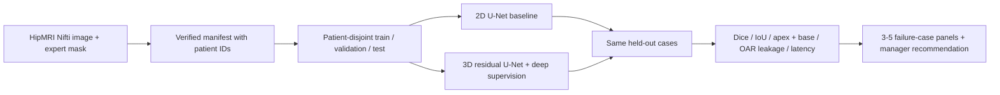

# HipMRI prostate segmentation: does 3D context help at the apex and base?

**COMP3710 tutor exemplar · Hard difficulty · 3D Improved U-Net**

This project studies whether a residual 3D U-Net with deep supervision gives more useful prostate contours than a standard slice-wise 2D U-Net. The intended user is a radiotherapy contouring specialist who would inspect and edit a draft contour. Global Dice alone can hide dangerous errors at the prostate apex and base, or false-positive contour inside the bladder and rectum. Both models are trained on the same patient-disjoint HipMRI split, then compared on whole-volume overlap, edge-slice overlap, anatomical leakage, inference time, and memory use. This is research software, not a clinical device.

> **Evidence status:** The downloaded HipMRI release supplies 211 paired native 3D MRI and semantic-mask volumes from 38 patients. All pairs passed a shape, affine, and integer-label audit. The course tutor confirmed native IDs 5=prostate, 3=bladder, and 4=rectum. A one-epoch CPU pilot trained and produced real-data prediction panels, but its small network and short training run did not meet the assignment's performance target. A 10-epoch, validation-only CPU tuning run has also completed; its scores are preliminary and appear below. A full-resolution GPU benchmark, target-GPU resource profile, and final specialist case review remain pending.

## Working principles

The baseline is a 2D U-Net that processes each axial MRI slice independently. The proposed model uses 3D convolution, skip connections, residual blocks, and two auxiliary segmentation heads during training. Both predict background or prostate from a normalized Nifti volume. Image volumes are reoriented to canonical axes, clipped at the 0.5th and 99.5th nonzero-intensity percentiles, standardized per case, and resampled to a fixed `[D,H,W]` grid with trilinear interpolation. Anatomical label maps use nearest-neighbor interpolation. Cross-entropy and a prostate Dice loss train the main head; auxiliary 3D heads add lower-resolution losses. Optional `--foreground-weight` adjusts the prostate term of cross-entropy and must be selected using validation data. Optional `--augment` applies random left-right flips to training images and their aligned masks for both models; validation and test data are never augmented. The reported CPU runs used the default, with augmentation off. The evaluation uses the same resampled cases and masks for both models.



The design follows [U-Net](https://arxiv.org/abs/1505.04597), [3D U-Net](https://arxiv.org/abs/1606.06650), and the residual/deep-supervision direction of [Isensee et al.](https://arxiv.org/abs/1802.10508). It is an independent implementation, not a reproduction of their exact networks.

## One-page feasibility review

**User need and scope.** A contouring specialist needs a draft prostate mask that saves editing time without hiding edge-slice under-contours or leakage into organs at risk. This prototype compares a 2D baseline with a 3D candidate on the 3D HipMRI T2-weighted volumes and semantic masks described in the course brief. The intended output is an editable research contour and a case-level uncertainty/failure review, not autonomous treatment planning.

**Acceptance criteria.** (1) No patient appears in more than one split, including repeated scan volumes. (2) The 3D model reaches the brief's mean held-out prostate Dice target of at least 0.70, reported both by scan and with each patient weighted equally. (3) The 3D model improves mean apex or base Dice by at least 0.05 over the 2D baseline, while its false-positive fraction within either bladder or rectum rises by no more than 0.5 percentage points. (4) The proposed contour is generated within 5 seconds per volume on the target GPU and uses at most 16 GiB peak GPU memory. (5) Five low-performing cases from different patients have inspectable input/ground-truth/prediction/error panels and a written failure explanation. These are goals to test, not achieved results.

**Model and course concepts.** A slice-wise U-Net is a clean baseline because it has no through-plane context. The 3D residual model tests whether volumetric receptive fields reduce jagged slice transitions. Deep supervision provides training signals at two decoder scales. Patient-level grouping prevents scan-level leakage. A binary prostate target keeps the principal clinical question focused; the original semantic mask remains available to count overlap with bladder and rectum.

**Preliminary feasibility evidence.** A three-patient synthetic Nifti smoke test exercised split creation, label loading, a forward/backward pass for both networks, checkpoint saving, test inference, metrics, and error-panel generation. The downloaded 3D release contains 211 image/mask pairs from 38 patients; every pair passed shape and affine checks, and every mask contains ID 5. The course tutor confirmed native IDs 5/3/4 for prostate/bladder/rectum. The default grid is `64×128×128`; a GPU resource pilot on Rangpur is needed before the full training job.

**Risks, budget, and fallback.** The principal risks are misidentified patient IDs, wrong semantic label IDs, lost small structures during resampling, class imbalance, and 3D GPU exhaustion. The planned development stage is a short baseline and 3D pilot, followed by validation-only tuning and a larger GPU run. If memory exceeds budget, reduce the 3D grid or network width and document the resulting resolution loss; retain the working 2D baseline. The first software pilot opened this test split before the validation-only gate was added. Subsequent tuning uses validation only, but later results on this same test split cannot be called an untouched blind benchmark.

## Data, preprocessing, and leakage prevention

The course brief locates 3D HipMRI images in `/home/groups/comp3710/HipMRI_Study_open/semantic_MRs` and semantic masks in `/home/groups/comp3710/HipMRI_Study_open/semantic_labels_only` on Rangpur. The downloaded [CSIRO HipMRI release](https://doi.org/10.25919/45t8-p065) is available locally in `semantic_MRs_anon` and `semantic_labels_anon`. Its ZIP matches the SHA-256 checksum in the downloaded metadata. These directories contain 211 image/mask pairs representing 38 patients. The data are **not included** in this repository. Never commit images, masks, or model weights.

The supplied local `keras_slices_data` is a different, preprocessed input: it has 11,460 training image/mask slice pairs, 660 validation pairs, and 540 test pairs. Filenames group them into 191, 11, and 9 scan visits respectively, each with 60 slices. The three partitions cover 31, 4, and 3 distinct patients with no patient overlap. This is enough for a **2D slice-based project**. The present experiment uses the newly supplied native 3D release instead.

Create a CSV with four columns: `case_id,patient_id,image,mask`. Each row represents a volume; multiple volumes from one patient must share the same verified patient ID. Absolute or manifest-relative paths work. The downloaded release names paired files `Case_004_Week0_LFOV.nii.gz` and `Case_004_Week0_SEMANTIC_LFOV.nii.gz`. `prepare_manifest.py` removes those known suffixes before pairing and extracts the patient number from the shared case key. Inspect pair counts before training; do not infer patient IDs from an unverified naming convention in another release.

The native masks contain integer IDs 0–5. The course tutor confirmed **5=prostate, 3=bladder, and 4=rectum** for these files. The downloaded metadata does not include a native ID legend; the names of IDs 1 and 2 remain anatomical inferences and are not used as targets here. The [CAN3D paper](https://arxiv.org/pdf/2109.05443) uses a different, one-based class numbering in its text; do not copy those numbers into the training command.

Run the audit before selecting mask IDs:

```bash
HIPMRI_ROOT=/Users/taki/Downloads/2021-09-20_Dowling_Jason_51392v2/data/HipMRI_study_complete_release_v1
python prepare_manifest.py \
  --image-dir "$HIPMRI_ROOT/semantic_MRs_anon" \
  --mask-dir "$HIPMRI_ROOT/semantic_labels_anon" \
  --image-suffix _LFOV --mask-suffix _SEMANTIC_LFOV \
  --patient-regex '^Case_([0-9]+)_Week[0-9]+$' \
  --out runs/hipmri_native/manifest.csv
python audit_data.py --manifest runs/hipmri_native/manifest.csv \
  --out runs/hipmri_native/data_audit.json
```

The audit reports the original semantic label IDs, case dimensions, voxel spacing, and image/mask alignment. The actual audit found 210 volumes of shape `256×256×128` and one of `256×256×144`; all 211 masks contain ID 5. Prostate ID 5 occupies about **0.10% of native voxels** across the release, so class imbalance is substantial. The training script requires the prostate ID and accepts the other two IDs for organ-at-risk leakage counts. It splits **patients**, not slices or volumes, with a fixed seed and target proportions 70%/15%/15%. The exact case assignment is saved in the run directory's `split.json` and reused on reruns. The same split and resized grid are used for both models. Each headline metric is reported both as a scan average and as a patient-balanced average, because patients contribute different numbers of weekly visits.

The binary target is encoded as two channels inside the Dice loss via PyTorch one-hot encoding. Cross-entropy receives integer class indices. Native mask labels are retained separately for bladder/rectum error counts. During training, validation metrics use the common **resampled grid**, and checkpoints are chosen by patient-balanced validation prostate Dice. A final evaluation also restores predictions with nearest-neighbor interpolation to the canonical native mask grid and reports native-grid Dice, IoU, and 95th-percentile surface distance in millimeters. Resampled edge-slice metrics and the prediction panels remain resolution-dependent. Inference latency measures the model call on an already preprocessed grid, not end-to-end clinical workflow time.

## Reproduce the experiment

Use Python 3.12 and install the exact versions in `requirements.txt`. On Rangpur, the course GPU cluster, install a PyTorch build appropriate for its CUDA driver using the [official PyTorch instructions](https://pytorch.org/get-started/locally/); then install the remaining pinned packages. The local smoke test used CPU PyTorch 2.11.0. From this directory:

```bash
python -m pip install -r requirements.txt
python -m pytest -q tests
python audit_data.py --manifest runs/hipmri_native/manifest.csv
python train.py --manifest runs/hipmri_native/manifest.csv \
  --prostate-label 5 --bladder-label 3 --rectum-label 4 \
  --out runs/hipmri --device cuda --epochs 60 --size 64 128 128 \
  --validation-only
python evaluate_test.py --manifest runs/hipmri_native/manifest.csv \
  --run-dir runs/hipmri --device cuda
python predict.py --manifest runs/hipmri_native/manifest.csv \
  --run-dir runs/hipmri --count 5 --device cuda
```

`train.py` trains the 2D U-Net and 3D Improved U-Net sequentially, chooses each checkpoint by patient-balanced validation prostate Dice, and plots losses and validation Dice. Run each resource or hyperparameter candidate with `--validation-only`; compare only validation metrics, choose one run and freeze its settings, then run `evaluate_test.py` on that directory with the **same manifest path** recorded during training. A later full run may add `--augment` after its value has been checked on validation data. The finalization command uses the saved best weights and saved patient split, writes native-grid and resampled-grid test metrics to `results.json` and `per_case.csv`, and refuses a second evaluation of the same run. It writes `test_evaluation_started.json` before opening test voxels; if it is interrupted, inspect the partial run manually before any attempt to rerun it. The training step also saves `2d_best.pt`, `3d_best.pt`, and curves. Profiles include optimizer-step counts and wall-clock fit time because the 2D slice sampler and 3D volume loader do not have equal steps per epoch. `predict.py --split val` can inspect validation-only runs; its default `--split test` refuses those runs. After finalization, it loads saved weights, prints case Dice values, and writes five low-Dice multi-panel figures from different patients plus `autopsy_index.csv` to `runs/hipmri/failure_cases`. The run directory is ignored by Git.

For a first resource pilot, add `--validation-only --epochs 1 --size 32 64 64 --width-3d 4 --width-2d 4`; this checks training and validation without opening the test set and cannot be used for final performance claims. The first one-epoch software pilot was run before `--validation-only` existed, so it exposed this split's test output; those figures and scores are explicitly exploratory. Re-evaluating this same test split after tuning remains an **internal comparison**, not an untouched blind estimate. A genuinely blind performance estimate requires a new independent patient cohort or a prospective holdout that has not been inspected. This Mac has CPU-only PyTorch, so a full experiment should use an appropriate GPU environment. Run long jobs as Slurm batch jobs on Rangpur according to the course cluster instructions.

A further **planned**, validation-only preprocessing experiment will test `--crop-xy 128`, reducing the in-plane field of view before resizing. Its usefulness must be decided from training anatomy checks and validation metrics alone; no crop result is reported here yet. A crop could remove anatomy or distort an edge if applied without checking coverage, so the full native mask must remain available for final scoring.

## Quantitative results and failure analysis

The completed 10-epoch CPU tuning run used the native release, a `32×64×64` grid, four base channels for each network, and cross-entropy foreground weight 1. It involved 34 validation visits from 6 patients. Checkpoints were chosen on patient-balanced validation prostate Dice. These resampled-grid values compare candidates; they are **not held-out test performance**.

| Validation-only CPU measure | 2D U-Net | 3D Improved U-Net |
| --- | ---: | ---: |
| Best checkpoint epoch | 5 | 6 |
| Patient-balanced prostate Dice | 0.606 | 0.597 |
| Patient-balanced apex / base Dice | 0.404 / 0.310 | 0.192 / 0.511 |
| Patient-balanced 95th-percentile surface distance, resampled voxels | 2.303 | 13.385 |

The 3D candidate improved base overlap in this small-grid validation run but performed substantially worse at the apex. This does not establish a clinical gain: nearest-neighbor resampling can erase fine boundaries, and the higher 3D surface-distance value warrants case-level inspection. The one-epoch CPU software check and its five observed panels are documented separately in [PILOT_NOTES.md](PILOT_NOTES.md).

The table below is reserved for a selected real-data run evaluated after validation-only tuning. Empty cells are intentional. Because the initial pilot exposed this same test split, fill it as an **internal test comparison**, with the split-exposure caveat alongside the numbers.

| Internal test metric | 2D U-Net baseline | 3D Improved U-Net |
| --- | ---: | ---: |
| Test patients / volumes | Awaiting selected run | Awaiting selected run |
| Native-grid prostate Dice / IoU, patient-balanced | Awaiting full run | Awaiting full run |
| Resampled-grid prostate Dice / IoU, patient-balanced | Awaiting full run | Awaiting full run |
| Background Dice / IoU | Awaiting full run | Awaiting full run |
| Apex Dice / base Dice; outside-extent false positives | Awaiting full run | Awaiting full run |
| 95th-percentile surface distance (native millimeters / resampled voxels) | Awaiting full run | Awaiting full run |
| False-positive voxels and fractions inside bladder / rectum | Awaiting full run | Awaiting full run |
| Parameters / peak GPU VRAM / case latency | Awaiting full run | Awaiting full run |

For the 3-5 case autopsies, inspect the `failure_cases/*.png` panels and report each case ID, patient ID, observed false-positive/false-negative boundary, whether the failure occurs at the apex/base or near an organ at risk, a plausible image-level trigger, and whether 3D helped relative to 2D. Include both false positives and false negatives. A low Dice score identifies cases to inspect; it does **not** by itself establish the cause. Add additional examples if the worst five fail to cover both error types.

**Manager recommendation (pending real-data evidence):** Retain mandatory specialist review of every contour, especially apex/base slices and any predicted voxels inside bladder or rectum. Advance the 3D model only if its held-out boundary gain survives the case-level failure review and justifies its extra memory and latency. The generated masks are not suitable for clinical use without a larger external validation and a native-space dosimetric assessment.

## Code map

| File | Responsibility |
| --- | --- |
| `modules.py` | PyTorch-only 2D baseline and residual 3D model components |
| `dataset.py` | Nifti loading, normalization, verified patient splitting, aligned training augmentation, 2D/3D datasets |
| `train.py` | Training, validation, optional direct test evaluation, checkpoints, curves, profiling |
| `evaluate_test.py` | One-time test evaluation of the selected validation-only run |
| `predict.py` | Saved-weight inference and visual error panels |
| `metrics.py` | Case-level Dice, IoU, surface, apex/base, and OAR leakage metrics |
| `audit_data.py`, `prepare_manifest.py` | Data inspection and optional manifest construction |
| `tests/test_pipeline.py` | Synthetic alignment, leakage, shape, gradient, and metric checks |

## Artificial Intelligence Usage Disclosure

OpenAI Codex assisted the tutor in drafting the project structure, PyTorch implementation, documentation, and debugging. The tutor exemplar's code was reviewed with syntax checks, automated synthetic tests, a complete one-epoch synthetic training and prediction smoke test, a native-data audit, a one-epoch CPU pilot on the real data, a validation-only CPU tuning run, and visual inspection of the pilot output panels. Synthetic tests check software operation only. The real-data pilot and tuning run do not establish final clinical performance. Clinical boundary quality and operating thresholds require a full experiment and specialist review. Students must independently implement, verify, cite, and disclose any AI assistance in their own submissions.

## References

1. Ronneberger et al., [U-Net: Convolutional Networks for Biomedical Image Segmentation](https://arxiv.org/abs/1505.04597), 2015.
2. Çiçek et al., [3D U-Net: Learning Dense Volumetric Segmentation from Sparse Annotation](https://arxiv.org/abs/1606.06650), 2016.
3. Isensee et al., [Brain Tumor Segmentation and Radiomics Survival Prediction](https://arxiv.org/abs/1802.10508), 2018.
4. COMP3710/COMP7710 Pattern Recognition Report (2026 draft), provided course assessment brief.
