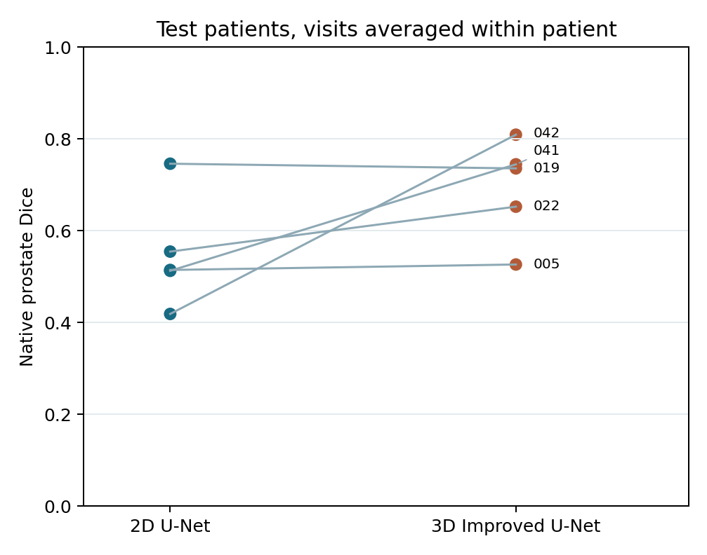
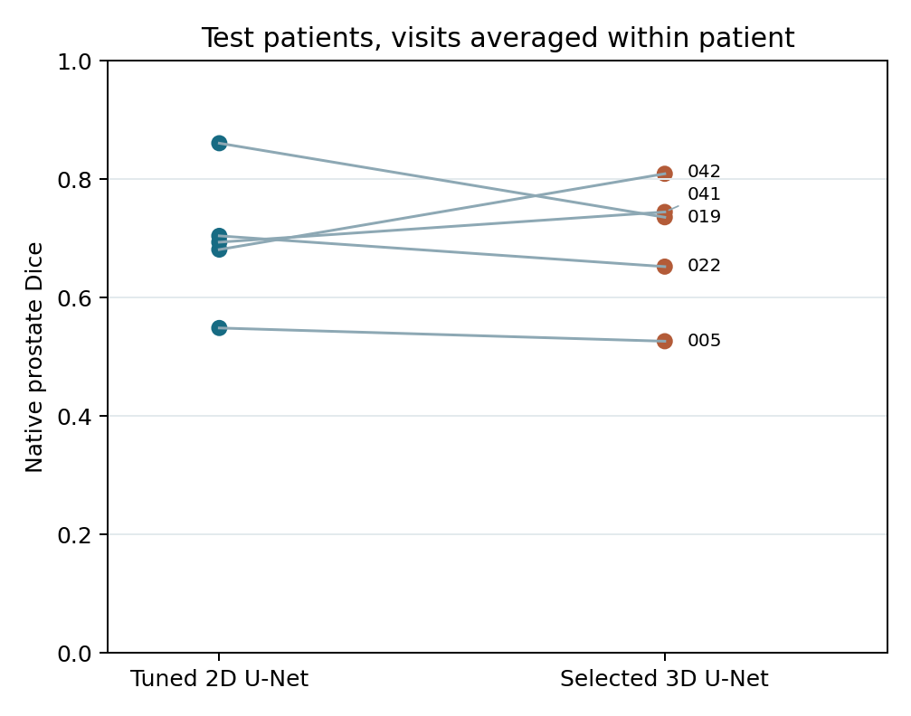
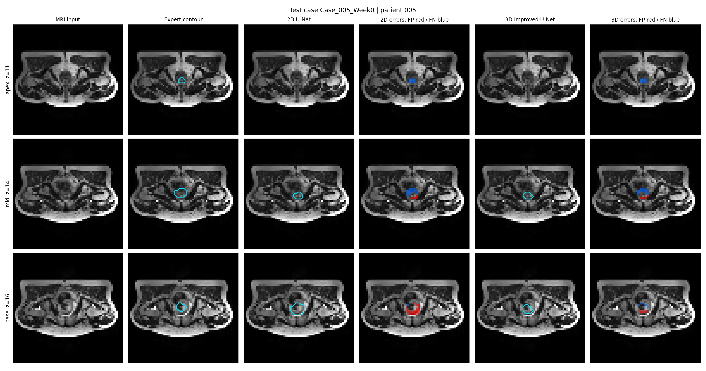
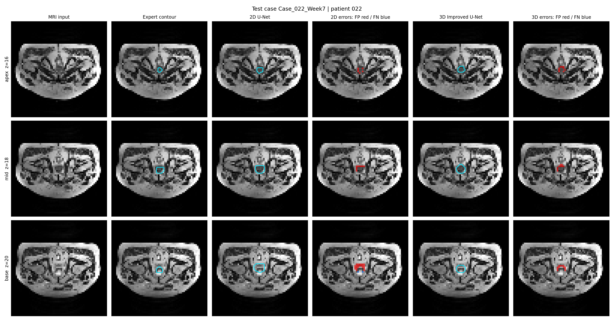
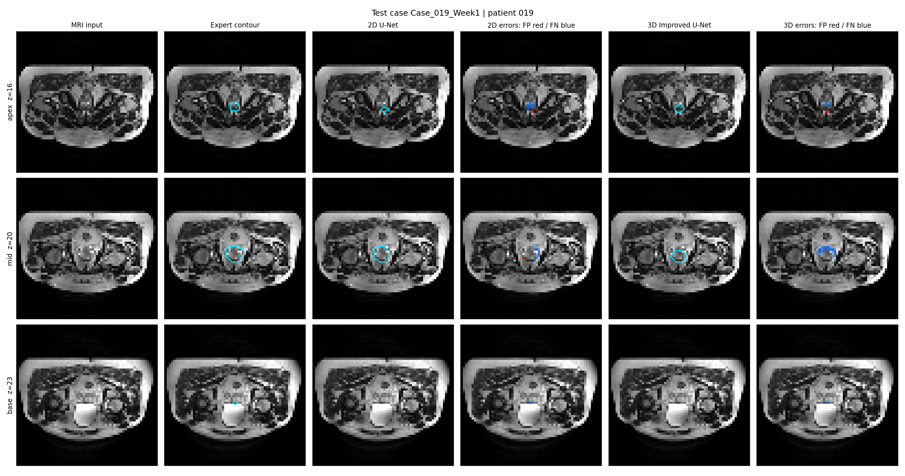
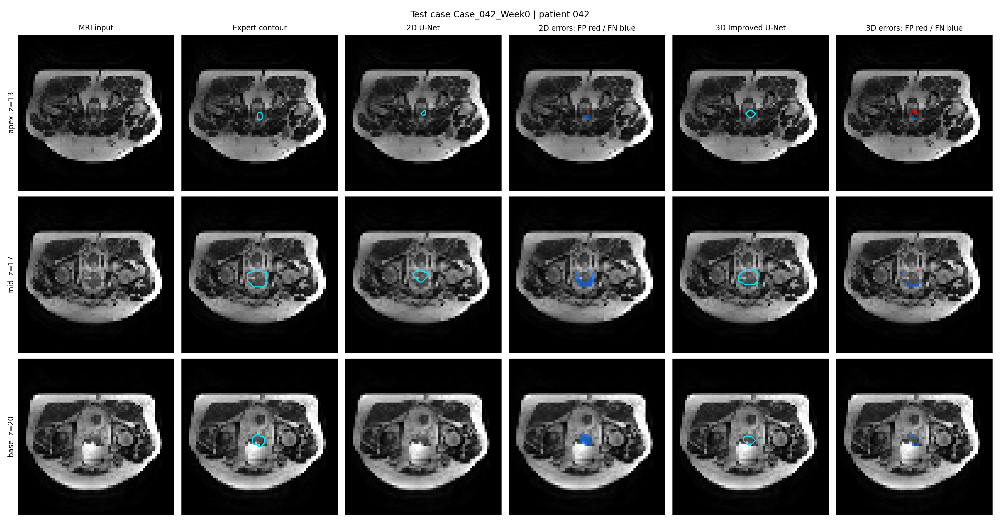
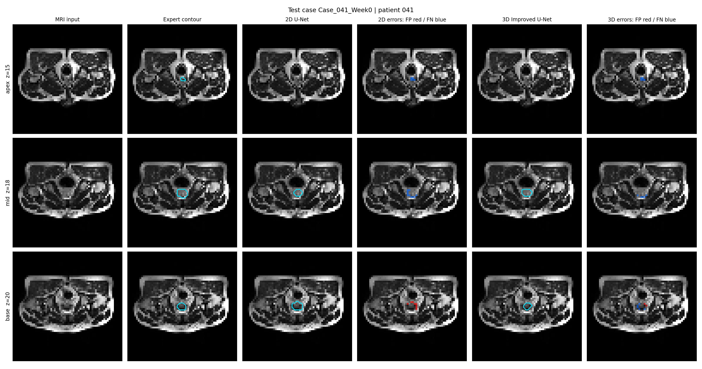

# HipMRI prostate segmentation: does 3D context help at the apex and base?

**COMP3710 tutor exemplar · Hard difficulty · 3D Improved U-Net**

This project studies whether a residual 3D U-Net with deep supervision gives more useful prostate contours than a standard slice-wise 2D U-Net. The intended user is a radiotherapy contouring specialist who would inspect and edit a draft contour. Global Dice alone can hide dangerous errors at the prostate apex and base, or false-positive contour inside the bladder and rectum. Both models are trained on the same patient-disjoint HipMRI split, then compared on whole-volume overlap, edge-slice overlap, anatomical leakage, and measured CPU cost. GPU memory remains an explicit measurement gap. This is research software, not a clinical device.

> **Evidence status (12 October 2026):** The native release supplies 211 paired 3D MRI/mask volumes from 38 patients; all pairs passed the shape, affine, and label audit. The course tutor confirmed IDs 5=prostate, 3=bladder, and 4=rectum. Four CPU candidates were compared on validation data. On the native grid of 23 test visits from five patients, 3D patient-balanced prostate Dice was **0.694**; a matched-preprocessing 2D baseline scored **0.549**, but the independently validation-selected 2D baseline scored **0.698**. The latter removes the apparent 3D Dice advantage. The 3D model reached **0.757** on its downsampled network grid, exceeding the brief's 0.70 target. An early pilot exposed this test split, so every test number is an internal exploratory result. Target-GPU memory, independent-cohort performance, and clinical utility are unmeasured.

## Working principles

The baseline is a 2D U-Net that processes each axial MRI slice independently. The proposed model uses 3D convolution, skip connections, residual blocks, and two auxiliary segmentation heads during training. Both predict background or prostate from a normalized Nifti volume. Image volumes are reoriented to canonical axes, clipped at the 0.5th and 99.5th nonzero-intensity percentiles, standardized per case, and resampled to a fixed `[D,H,W]` grid with trilinear interpolation. Anatomical label maps use nearest-neighbor interpolation. Cross-entropy and a prostate Dice loss train the main head; auxiliary 3D heads add lower-resolution losses. Optional `--foreground-weight` adjusts the prostate term of cross-entropy and must be selected using validation data. Optional `--augment` applies random left-right flips to training images and their aligned masks for both models; validation and test data are never augmented. The reported CPU runs had augmentation off.

At width 4 and input grid `32×64×64`, the 3D encoder has channel widths 4, 8, 16, and 32, with three 2× pooling steps. Decoder skip concatenations restore the grid; residual blocks add identity or 1×1 projection paths. Its auxiliary heads supervise decoder grids `8×16×16` and `16×32×32`; only the final full-grid head is used for inference. Both models minimize weighted cross-entropy plus soft prostate Dice loss; the auxiliary 3D losses add weights 0.25 and 0.125. The 2D trainer samples foreground-containing slices more often, while the 3D trainer samples volumes. These architecture and sampling differences mean an observed gain cannot be attributed to through-plane context alone. The controlled comparison shares the full-field preprocessing; the separately tuned 2D baseline uses a validation-selected central crop, and both are scored on the same native test masks.


The design follows [U-Net](https://arxiv.org/abs/1505.04597), [3D U-Net](https://arxiv.org/abs/1606.06650), and the residual/deep-supervision direction of [Isensee et al.](https://arxiv.org/abs/1802.10508). It is an independent implementation, not a reproduction of their exact networks.

## One-page feasibility review

**User need and scope.** A contouring specialist needs a draft prostate mask that saves editing time without hiding edge-slice under-contours or leakage into organs at risk. This prototype compares a 2D baseline with a 3D candidate on the 3D HipMRI T2-weighted volumes and semantic masks described in the course brief. The intended output is an editable research contour and a case-level uncertainty/failure review, not autonomous treatment planning.

**Acceptance criteria and outcome.** (1) Patient-disjoint splitting: met by the saved 27/6/5-patient split. (2) The brief's downsampled 3D test Dice target of at least 0.70: met on the resampled grid (patient mean 0.757; scan mean 0.737). A stricter native-grid check remains below 0.70 (patient mean 0.694; scan mean 0.665). (3) Mean apex or base Dice gain at least 0.05 without more than 0.5 percentage-point extra bladder/rectum false-positive fraction: met only against the common-configuration 2D baseline; the tuned 2D baseline slightly exceeds 3D native apex/base Dice, so no robust 3D boundary advantage is established. (4) Under 5 seconds and 16 GiB on the target GPU: unverified; model-only CPU latency was 74 ms and no GPU memory measurement exists. (5) Five distinct-patient case panels and written review: completed. These are local project goals, not a course grade or evidence of clinical readiness.

**Model and course concepts.** A slice-wise U-Net is a clean baseline because it has no through-plane context. The 3D residual model tests whether volumetric receptive fields reduce jagged slice transitions. Deep supervision provides training signals at two decoder scales. Patient-level grouping prevents scan-level leakage. A binary prostate target keeps the principal clinical question focused; the original semantic mask remains available to count overlap with bladder and rectum.

**Feasibility evidence.** A synthetic Nifti smoke test exercised loading, splitting, gradient flow, checkpointing, inference, metrics, and figures. The native audit passed for all 211 pairs and found prostate ID 5 in every mask. A train/validation-only crop audit found every prostate inside a central 128×128 crop, but the best 3D validation candidate still used the full field. The reported experiment uses a CPU-friendly `32×64×64` grid and four starting channels per model. The code supports a larger grid, but the final measured result belongs to this low-resolution configuration.

**Risks, budget, and fallback.** The measured risks are class imbalance, small structures lost during resampling, weak apex contours, and inter-patient variation. A larger 3D grid may improve detail but needs a new validation-only resource pilot and a target-GPU memory check. The independently tuned 2D baseline is the lower-cost fallback because it slightly exceeds the selected 3D model's native Dice here. The first one-epoch software pilot opened this same test split before the validation-only gate was added. Later test scores are therefore internal comparisons, not blind estimates; a genuinely blind estimate needs an independent patient cohort or a prospective unseen holdout.

## Data, preprocessing, and leakage prevention

The course brief locates 3D HipMRI images in `/home/groups/comp3710/HipMRI_Study_open/semantic_MRs` and semantic masks in `/home/groups/comp3710/HipMRI_Study_open/semantic_labels_only` on Rangpur. The downloaded [CSIRO HipMRI release](https://doi.org/10.25919/45t8-p065) is available locally in `semantic_MRs_anon` and `semantic_labels_anon`. Its ZIP matches the SHA-256 checksum in the downloaded metadata. These directories contain 211 image/mask pairs representing 38 patients. **Raw NIfTI volumes and masks are not included** in this source repository; the report includes only anonymized illustrative figures. Keep the raw data and model weights out of Git.

The supplied local `keras_slices_data` is a different, preprocessed input: it has 11,460 training image/mask slice pairs, 660 validation pairs, and 540 test pairs. Filenames group them into 191, 11, and 9 scan visits respectively, each with 60 slices. The three partitions cover 31, 4, and 3 distinct patients with no patient overlap. This is enough for a **2D slice-based project**. The present experiment uses the newly supplied native 3D release instead.

Create a CSV with four columns: `case_id,patient_id,image,mask`. Each row represents a volume; multiple volumes from one patient must share the same verified patient ID. Absolute or manifest-relative paths work. The downloaded release names paired files `Case_004_Week0_LFOV.nii.gz` and `Case_004_Week0_SEMANTIC_LFOV.nii.gz`. `prepare_manifest.py` removes those known suffixes before pairing and extracts the patient number from the shared case key. Inspect pair counts before training; do not infer patient IDs from an unverified naming convention in another release.

The native masks contain integer IDs 0–5. The course tutor confirmed **5=prostate, 3=bladder, and 4=rectum** for these files. The downloaded metadata does not include a native ID legend; the names of IDs 1 and 2 remain anatomical inferences and are not used as targets here. The [CAN3D paper](https://arxiv.org/pdf/2109.05443) uses a different, one-based class numbering in its text; do not copy those numbers into the training command.

Run the audit before selecting mask IDs:

```bash
HIPMRI_ROOT=/Users/taki/Downloads/2021-09-20_Dowling_Jason_51392v2/data/HipMRI_study_complete_release_v1
python prepare_manifest.py \
  --image-dir "$HIPMRI_ROOT/semantic_MRs_anon" \
  --mask-dir "$HIPMRI_ROOT/semantic_labels_anon" \
  --image-suffix _LFOV --mask-suffix _SEMANTIC_LFOV \
  --patient-regex '^Case_([0-9]+)_Week[0-9]+$' \
  --out runs/hipmri_native/manifest.csv
python audit_data.py --manifest runs/hipmri_native/manifest.csv \
  --out runs/hipmri_native/data_audit.json
```

The audit reports the original semantic label IDs, case dimensions, voxel spacing, and image/mask alignment. The actual audit found 210 volumes of shape `256×256×128` and one of `256×256×144`; all 211 masks contain ID 5. Prostate ID 5 occupies about **0.10% of native voxels** across the release, so class imbalance is substantial. The training script requires the prostate ID and accepts the other two IDs for organ-at-risk leakage counts. It splits **patients**, not slices or volumes, with a fixed seed and target proportions 70%/15%/15%. The exact assignment is saved in `split.json`. The two models in the common-configuration comparison share both split and resized grid; the independently tuned 2D model keeps the split but uses a central crop. Native-grid scoring gives all models the same physical reference. Each headline metric is reported both as a scan average and as a patient-balanced average, because patients contribute different numbers of weekly visits.

The binary target is encoded as two channels inside the Dice loss via PyTorch one-hot encoding. Cross-entropy receives integer class indices. Native semantic labels are retained separately for bladder/rectum error counts. Validation uses each candidate's **resampled grid**, and checkpoints are selected by patient-balanced validation prostate Dice. The locked test evaluation restores predictions with nearest-neighbor interpolation to the canonical native mask grid and computes native-grid Dice, IoU, apex/base Dice, anatomical leakage, and 95th-percentile surface distance in millimeters. A complete miss is assigned the image diagonal as an HD95 penalty instead of being dropped. The five panels show the **full-field resampled grid** for the common-configuration pair; they do not display the separately tuned cropped 2D model. Latency times the model call after preprocessing, not a clinical workflow.

## Reproduce the experiment

Use Python 3.12 and install the exact versions in `requirements.txt`. The measured run used CPU PyTorch 2.11.0. On Rangpur, install a PyTorch build appropriate for its CUDA driver using the [official PyTorch instructions](https://pytorch.org/get-started/locally/). From this directory, create the manifest as shown above, then run:

```bash
python -m pip install -r requirements.txt
python -m pytest -q tests
python train.py --manifest runs/hipmri_native/manifest.csv \
  --prostate-label 5 --bladder-label 3 --rectum-label 4 \
  --out runs/hipmri_native_weight20 --device cpu --seed 3710 \
  --size 32 64 64 --width-2d 4 --width-3d 4 \
  --lr 0.001 --foreground-weight 20 --epochs 10 --patience 10 \
  --batch-2d 16 --batch-3d 1 --validation-only
python evaluate_test.py --manifest runs/hipmri_native/manifest.csv \
  --run-dir runs/hipmri_native_weight20 --device cpu
python predict.py --manifest runs/hipmri_native/manifest.csv \
  --run-dir runs/hipmri_native_weight20 --count 5 --device cpu
python analyze_results.py \
  --per-case runs/hipmri_native_weight20/per_case.csv \
  --out runs/hipmri_native_weight20/paired_summary.json \
  --figure figures/patient_dice_comparison.png
```

The stronger 2D comparator was chosen **independently on validation data** as the highest 2D patient-balanced Dice among the four candidates. For a fresh reproduction, train it in a new directory using the same patient split and these settings, then run its one-time 2D test evaluation:

```bash
python train.py --manifest runs/hipmri_native/manifest.csv \
  --prostate-label 5 --bladder-label 3 --rectum-label 4 \
  --out runs/hipmri_native_crop128_weight20 --device cpu --seed 3710 \
  --size 32 64 64 --crop-xy 128 --width-2d 4 --width-3d 4 \
  --lr 0.001 --foreground-weight 20 --epochs 10 --patience 10 \
  --batch-2d 16 --batch-3d 1 --validation-only
python evaluate_2d_baseline.py \
  --manifest runs/hipmri_native/manifest.csv \
  --run-dir runs/hipmri_native_crop128_weight20 \
  --reference-run runs/hipmri_native_weight20 --device cpu
python compare_models.py \
  --selected-per-case runs/hipmri_native_weight20/per_case.csv \
  --baseline-per-case runs/hipmri_native_crop128_weight20/2d_baseline_per_case.csv \
  --out-csv runs/hipmri_native_crop128_weight20/paired_per_case.csv \
  --out-json runs/hipmri_native_crop128_weight20/paired_comparison.json \
  --figure figures/tuned_2d_vs_selected_3d.png
```

`evaluate_2d_baseline.py` checks that the patient partitions and manifest match the finalized 3D run, claims the candidate's test split once, evaluates only its selected 2D checkpoint, and writes `2d_baseline_test.json` and `2d_baseline_per_case.csv`. The included evidence archive contains this completed comparison. The two models have different training preprocessing, so use **native-grid** metrics for their head-to-head comparison; their separate resampled-grid Dice values are not directly comparable.

`compare_models.py` checks that the two saved per-case files cover exactly the same patients and visits before producing the paired summary and figure; it does not reopen test images.

The command sequence documents the **configuration and one-time workflow**; the included evidence archive contains the already evaluated runs. Use fresh output directories if retraining. `train.py` is validation-only by default, fits both models sequentially, and chooses each best checkpoint using patient-balanced validation Dice. An explicit `--evaluate-test` permits immediate testing for a prespecified final run; the separate `evaluate_test.py` gate was used here. That gate requires the recorded manifest, split, and preprocessing; it writes `results.json` and `per_case.csv`, places `test_evaluation_started.json` before reading test voxels, and refuses a second evaluation of that run. `predict.py` produces five distinct-patient, three-slice panels. `analyze_results.py` computes descriptive paired patient-bootstrap intervals with 10,000 resamples and plots each patient's mean Dice. Run directories are ignored by Git; the source archive contains no raw dataset or weights.

For further model or resource tuning, use `--validation-only` and view only validation results (`predict.py --split val`). The one-epoch software pilot predates this gate and exposed the same test split. This is disclosed alongside every test result. The saved test run must not be re-evaluated to choose thresholds or settings; a fresh independent cohort is needed for an unbiased external estimate. CPU timings from this Mac do not establish GPU performance. On Rangpur, a fresh validation-only run with `--device cuda` in a new output directory records `2d.profile.peak_device_memory_mb` and `3d.profile.peak_device_memory_mb` in `results.json`; report the GPU model, input grid, and per-case validation latency with those numbers. Follow the course cluster's Slurm instructions. No target-GPU value is inferred from the CPU run.

Optional `--crop-xy 128` takes a fixed central 128×128 crop before resizing. On train/validation masks, all 188 prostates were contained. The validation label-resampling round-trip Dice ceiling improved from 0.780 to 0.864. Cropping lowered 3D validation Dice relative to the full-field candidate but improved the 2D candidate; it was selected for the stronger 2D comparator. The native mask remains the scoring reference. Optional `--augment` applies paired image/mask flips in training only; it was off for every reported run, so no augmentation benefit is claimed.

## Quantitative results and failure analysis

Four candidates used the **same** patient split: 154 training visits (27 patients), 34 validation visits (6 patients), and 23 reserved test visits (5 patients). The 3D choice was made by the highest patient-balanced **resampled validation** Dice for 3D; the stronger 2D baseline was chosen independently by the same criterion for 2D. The probability threshold of 0.5 was retained after a validation-only sweep for the 3D choice. The final checkpoint-selection rule used validation metrics, after an earlier software pilot had exposed this test split. All runs used grid `32×64×64`, four starting channels per network, learning rate 0.001, and checkpoint selection on validation data.

| Validation-only candidate | 2D patient Dice | 3D patient Dice |
| --- | ---: | ---: |
| Full field; foreground weight 1; 10 epochs | 0.606 | 0.597 |
| Full field; weight 20; 10 epochs (**3D selected**) | 0.631 | **0.684** |
| Central crop 128; weight 20; 10 epochs (**2D selected**) | **0.708** | 0.637 |
| Central crop 128; weight 5; 15 epochs | 0.700 | 0.667 |

The crop improved the 2D candidate but reduced the 3D validation score relative to the full-field 3D choice. These validation scores are not test performance. The full-field 2D and 3D checkpoints were epochs 6 and 5; the independently selected cropped 2D checkpoint was from its own validation-only run. The earlier one-epoch software check is described in [PILOT_NOTES.md](PILOT_NOTES.md).

### Internal test comparison

The full-field 3D run and the independently selected 2D checkpoint were each evaluated once on the **same 23 visits from five patients**. **The split had already been viewed in the early pilot**, so these are internal exploratory comparisons, not untouched estimates of generalization. Patient-balanced figures average each patient's visits first; scan averages give each visit equal weight. The first table holds preprocessing fixed between 2D and 3D and comes from the selected run's `results.json` and `per_case.csv`.

| Common full-field preprocessing | 2D U-Net | 3D Improved U-Net |
| --- | ---: | ---: |
| Native prostate Dice, patient mean | 0.549 | **0.694** |
| Native prostate Dice, scan mean | 0.605 | **0.665** |
| Native prostate IoU, patient mean | 0.390 | **0.542** |
| Resampled prostate Dice, patient mean | 0.610 | **0.757** |
| Resampled prostate Dice, scan mean | 0.668 | **0.737** |
| Native background Dice, patient mean | 0.99952 | 0.99969 |
| Native background IoU, patient mean | 0.99904 | 0.99937 |

Within the common full-field setup, the native patient-balanced Dice gain was **+0.144**. A paired bootstrap over five patients gave a descriptive 95% interval of **+0.020 to +0.283** (10,000 resamples). Background scores are near 1 because background dominates the image; they do not establish contour quality. The brief specifies downsampled HipMRI 3D data, and the 3D model exceeds its 0.70 Dice target on that network grid. Restoring contours to native resolution reduces the 3D patient mean to 0.694 and scan mean to 0.665. This common-configuration comparison is useful for control, but its 2D candidate was weaker on validation than a cropped 2D candidate.

| Common full-field native boundary/resource metric | 2D U-Net | 3D Improved U-Net |
| --- | ---: | ---: |
| Apex Dice, patient mean | 0.301 | 0.348 |
| Base Dice, patient mean | 0.449 | **0.636** |
| HD95, patient mean (mm; lower is better) | 14.41 | **8.17** |
| False-positive voxels beyond gland slice extent, patient mean | 1,270 | **425** |
| False-positive fraction inside bladder, patient mean | 2.28% | **0.97%** |
| False-positive fraction inside rectum, patient mean | 0.341% | **0.261%** |
| Trainable parameters | 30,782 | 93,358 |
| Model-only CPU inference, patient mean | 50.1 ms | 74.0 ms |
| CPU fit including validation | 240 s | 469 s |
| Peak target-GPU memory | Unmeasured | Unmeasured |

Against the common full-field 2D baseline, native base Dice increased by +0.188 (paired patient-bootstrap interval -0.018 to +0.508); apex Dice increased by +0.047 (interval -0.079 to +0.180). The base point estimate meets the local 0.05 edge-slice goal but is uncertain across five patients. HD95 fell by 6.23 mm (descriptive interval -10.46 to -2.01 mm). This does **not** establish that 3D context caused the gain: the models also differ in residual blocks, deep supervision, and 2D slice sampling.



### Stronger independently tuned 2D baseline

The central-crop 2D model had the highest 2D validation Dice (0.708), selected **before its one-time test evaluation**. It uses the same patients and native test masks as the full-field 3D model; the input crop differs. Native metrics therefore give the fairest available comparison. The independent 2D result is saved in `2d_baseline_test.json` and `2d_baseline_per_case.csv` in the evidence archive.

| Native-grid test metric, patient mean | Tuned 2D crop | Selected 3D full field |
| --- | ---: | ---: |
| Prostate Dice | **0.698** | 0.694 |
| Prostate IoU | **0.548** | 0.542 |
| Apex Dice | **0.388** | 0.348 |
| Base Dice | **0.645** | 0.636 |
| HD95, mm (lower is better) | 9.11 | **8.17** |
| False-positive voxels beyond gland slice extent | 656 | **425** |
| False-positive fraction inside bladder | 1.16% | **0.97%** |
| False-positive fraction inside rectum | **0.221%** | 0.261% |
| Trainable parameters | **30,782** | 93,358 |
| Model-only CPU inference | **52.1 ms** | 74.0 ms |
| CPU fit including validation | **239 s** | 469 s |
| Peak target-GPU memory | Unmeasured | Unmeasured |

The 3D-minus-tuned-2D native Dice difference is **-0.004**, with a descriptive paired five-patient bootstrap interval of **-0.075 to +0.077**. Both apex and base Dice are slightly lower for 3D; its HD95 and outside-extent false positives are better, but the HD95 difference interval spans zero. The small cohort and prior test exposure rule out a strong generalization claim. Resampled-grid Dice cannot be compared head-to-head here because the crop changes what each network-grid voxel represents. CPU timing excludes Nifti loading, preprocessing, and contour review; peak GPU VRAM remains unmeasured.



### Five distinct-patient case reviews

The panels show the **coarse full-field resampled grid**, comparing 3D with the common-configuration 2D model. They do **not** display the independently tuned cropped 2D model. Cyan outlines are expert or model contours; in error columns, red means false-positive prediction and blue means missed expert prostate. Cases were selected by lowest 3D Dice with at most one visit per patient, before the tuned-2D robustness comparison. The native Dice figures below come from `per_case.csv`; they can differ from panel-grid Dice. A visible disagreement is an observed failure, but its image-level cause remains a hypothesis without specialist adjudication.

1. **Case_005_Week0, patient 005; native Dice 0.259 → 0.369.** Both models nearly omit the small apex target; the 3D native apex Dice is 0. At mid gland the 3D outline is too small, with clear blue missed pixels. At the base, 2D extends beyond the expert boundary while 3D follows it more closely but still has red and blue edge errors. Small target size and coarse resampling are plausible contributors, not proven causes. Trigger for review: empty apex prediction or blue edge band.



2. **Case_022_Week7, patient 022; native Dice 0.532 → 0.684.** The 3D mid-gland contour is more centered, but still adds red pixels at an outer edge. Both models over-extend part of the base. Native bladder false-positive fraction remains 4.6% for 3D, despite improving from 8.7% for 2D. Trigger: any contour touching bladder or extending above the expert gland extent.



3. **Case_019_Week1, patient 019; native Dice 0.718 → 0.609.** This is a counterexample: 2D is better. The 3D mid-gland outline underfills the upper boundary, and the small base target is poorly captured by both models. Native base Dice drops from 0.517 to 0.399; 3D HD95 rises from 9.36 to 13.42 mm. Trigger: substantial blue under-contour even when a 3D outline looks smooth.



4. **Case_042_Week0, patient 042; native Dice 0.419 → 0.809.** At the apex, the 2D contour is displaced from the small expert target while 3D is closer. At mid gland, 2D leaves a broad blue missed region. At the base, 2D misses the contour entirely (native base Dice 0), while 3D recovers most of it (0.800) with some remaining blue pixels. Trigger: a blank base slice or displaced apex outline.



5. **Case_041_Week0, patient 041; native Dice 0.513 → 0.745.** Both models miss the tiny apex target (native apex Dice 0 for both). The 2D mid-gland mask leaves a broad blue inferior edge; its base contour adds red false-positive pixels. The 3D contours are closer at mid/base but retain missed pixels. Trigger: an empty apex slice despite good whole-volume Dice.



**Recommendation to the contouring manager.** Keep both models as **research drafts requiring specialist review of every case and edge slice**; accept zero contours automatically. Prioritize empty apex/base slices, blue under-contours, and predicted voxels inside bladder or rectum. The 3D model had lower observed mean HD95 and fewer predictions beyond gland extent than tuned 2D, but its native Dice and apex/base overlap were no better, while CPU inference took about 22 ms longer. These differences are uncertain across five patients. A 3D deployment recommendation is therefore **not justified by this cohort**. Use the cheaper tuned 2D model as the next research baseline and test both at higher resolution on an independent patient cohort with target-GPU memory/latency, specialist adjudication, and native-space dosimetry before clinical consideration.

## Code map

| File | Responsibility |
| --- | --- |
| `modules.py` | PyTorch-only 2D baseline and residual 3D model components |
| `dataset.py` | Nifti loading, normalization, verified patient splitting, aligned training augmentation, 2D/3D datasets |
| `train.py` | Validation-gated training, patient-balanced checkpoint selection, curves, profiling |
| `evaluate_test.py` | One-time test evaluation of the selected validation-only run |
| `evaluate_2d_baseline.py` | One-time native-grid evaluation of an independently validation-selected 2D comparator on the same patient split |
| `predict.py` | Saved-weight inference and six-column visual error panels |
| `metrics.py` | Native and resampled Dice, IoU, HD95, apex/base, and organ leakage metrics |
| `audit_data.py`, `prepare_manifest.py` | Data inspection and optional manifest construction |
| `analyze_crop.py` | Train/validation-only crop coverage and label round-trip audit |
| `analyze_results.py` | Patient-level paired bootstrap and Dice figure |
| `compare_models.py` | Checked pairing of the independently tuned 2D run with the selected 3D run |
| `tests/` | Synthetic alignment, leakage, shape, gradient, locked-evaluation, and metric checks |

## Artificial Intelligence Usage Disclosure

OpenAI Codex assisted the tutor in designing, implementing, debugging, training, analyzing, plotting, and writing this exemplar. The tutor confirmed the mask IDs; the rest of the recorded computational audit and analysis was performed with Codex assistance. The project passed automated synthetic checks, a native-data audit, four validation-only CPU candidate comparisons, one selected-run test evaluation, a one-time independently selected 2D robustness evaluation, and visual review of five test panels. These checks establish that the code ran and that the reported numbers match saved outputs; they do not establish clinical safety, causal explanations for errors, or independent generalization. The tutor's AI-assisted commit history cannot serve as evidence of a student's individual originality. Students must independently implement, verify, cite, and disclose any AI assistance in their own submissions.

## References

1. Ronneberger et al., [U-Net: Convolutional Networks for Biomedical Image Segmentation](https://arxiv.org/abs/1505.04597), 2015.
2. Çiçek et al., [3D U-Net: Learning Dense Volumetric Segmentation from Sparse Annotation](https://arxiv.org/abs/1606.06650), 2016.
3. Isensee et al., [Brain Tumor Segmentation and Radiomics Survival Prediction](https://arxiv.org/abs/1802.10508), 2018.
4. COMP3710/COMP7710 Pattern Recognition Report (2026 draft), provided course assessment brief.
